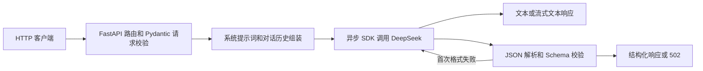

# FastAPI LLM 后端

一个面向技术问答的 Python API 服务。它通过异步 OpenAI SDK 接入 DeepSeek，提供普通对话、结构化 JSON 和分块文本三种响应方式。结构化接口校验模型输出，并在格式不合格时进行一次修复重试。模型交互通过 mock 测试复现，评审者可以在本地验证主要行为。

## 技术栈

Python 3.12、FastAPI、Pydantic v2、Uvicorn、OpenAI Python SDK（DeepSeek 兼容接口）、python-dotenv、pytest 和 FastAPI TestClient。

## 架构与实现



- **对话上下文**由客户端随请求传入。`history` 最多接收 20 条消息，组装时从最新消息向前选取连续历史，历史正文合计最多 4,000 字符。当前问题和系统提示词单独组装。
- **结构化输出**使用 JSON 模式生成 `summary`、`key_points` 和 `next_action`，再经过 JSON 解析和 Pydantic 校验。首次格式失败会追加修复指令，第二次仍失败返回带错误码的 `502`。
- **调用元数据**包括模型标识和可用的 Token 用量。结构化接口还返回 Prompt 版本、耗时和尝试次数。有两次格式尝试时，会累加供应商返回的用量。格式校验流程的成功与最终失败日志记录元数据，日志字段仅包含模型、版本、耗时、次数、用量和错误码等。
- **本地任务查询**从固定教学样例读取任务，供查看独立于模型的 API 路径。

### 项目文件

| 文件 | 用途 |
| --- | --- |
| `main.py` | 请求和响应模型、路由、LLM 调用、结构化校验和日志 |
| `token_usage.py` | Token 用量模型与累加逻辑 |
| `project_tool.py`、`project_tasks.py`、`task_snapshot.py` | 本地任务查询入口、查询逻辑和固定样例 |
| `test_main.py`、`test_project_tasks.py` | 接口、模型调用行为和任务查询逻辑的测试 |
| `requirements.txt`、`requirements-dev.txt` | 运行与测试依赖 |
| `.env.example`、`.gitignore` | 本地配置模板与 Git 忽略规则 |

## API

| 方法 | 路径 | 输入与响应 |
| --- | --- | --- |
| `GET` | `/health` | 返回 `{"status":"ok"}`，可用于本地启动检查 |
| `POST` | `/chat` | 接收对话请求，返回 `answer`、`model`、可空的 `usage` |
| `POST` | `/chat/structured` | 接收对话请求，返回结构化 `answer`、模型标识、Prompt 版本、耗时、尝试次数和可空的 `usage` |
| `POST` | `/chat/stream` | 接收对话请求，通过 `text/plain` 逐段返回模型文本 |
| `GET` | `/project-tasks/{project}` | 支持 `agent` 和 `bishe` 两个样例名称，未知名称返回 `400` |
| `POST` | `/greet`、`/echo`、`/rectangle` | 分别验证 `name`、`text` 和 `width` / `height` 的基础请求与响应 |

三个聊天接口使用相同请求体。`history` 可省略，历史角色支持 `user` 和 `assistant`。

```json
{
  "message": "用三句话解释 FastAPI 的依赖注入。",
  "history": []
}
```

请求体校验失败返回 `422`。模型请求超时映射为 `504`，连接、认证和其他 SDK 请求错误映射为 `502`。流式接口的 HTTP 错误映射覆盖建立上游流的阶段，响应体为纯文本分块。

## 本地启动

在仓库根目录使用 Python 3.12。以下命令用配置模板中的占位值启动服务，适合检查健康接口、OpenAPI 文档和本地任务接口。实际调用聊天接口时，将 `.env` 中的 `DEEPSEEK_API_KEY` 换为自己的 DeepSeek Key。聊天请求会向 DeepSeek 发送当前问题和选中的历史，可能产生费用。

**Windows PowerShell**

```powershell
py -3.12 -m venv .venv
.\.venv\Scripts\python.exe -m pip install -r requirements.txt
Copy-Item .env.example .env
.\.venv\Scripts\python.exe -m uvicorn main:app --host 127.0.0.1 --port 8000
```

**macOS / Linux**

```bash
python3.12 -m venv .venv
./.venv/bin/python -m pip install -r requirements.txt
cp .env.example .env
./.venv/bin/python -m uvicorn main:app --host 127.0.0.1 --port 8000
```

启动后打开 Swagger UI 试用接口，或在另一个终端用 `curl`（Windows 可用 `curl.exe`）请求健康检查。 [Swagger UI](http://127.0.0.1:8000/docs)

```text
curl http://127.0.0.1:8000/health
```

## 测试

测试通过 TestClient 直接调用 FastAPI，模型请求由 mock 提供。运行时使用占位值即可，无需启动 Uvicorn。覆盖普通对话、历史字符预算、结构化修复重试、Token 用量累加、流式文本、异常映射和本地任务查询逻辑。

```powershell
.\.venv\Scripts\python.exe -m pip install -r requirements-dev.txt
$env:DEEPSEEK_API_KEY = 'offline-placeholder'
.\.venv\Scripts\python.exe -m pytest -q
```

```bash
./.venv/bin/python -m pip install -r requirements-dev.txt
DEEPSEEK_API_KEY=offline-placeholder ./.venv/bin/python -m pytest -q
```

2026-11-20 在 Windows / Python 3.12.14 的新虚拟环境中验证，安装运行依赖后，`/health`、`/docs`、`/openapi.json` 和 `/project-tasks/agent` 均返回 `200`。安装测试依赖后，离线测试结果为 `29 passed`。真实 DeepSeek 响应与性能未在本轮验证。

## 演示截图建议

1. Swagger UI 展开 `/chat/structured` 和 `/chat/stream`，展示请求模型和路由。
2. 展示结构化修复重试的测试响应及 `attempts` 和 `usage` 字段。沿用上一节对应系统的 Python 和环境变量，将 `-m pytest -q` 改为 `-m pytest -q -s test_main.py::test_chat_structured_retries_once_and_succeeds`，截图标注“模拟模型响应”。
3. 展示 `pytest -q` 的完整汇总和 `/health` 的返回结果。截图使用示例输入，裁去本机路径和个人信息。

## 后续计划

RAG 的文档切分、检索和引用，以及 Agent 的模型驱动工具选择与调用编排，属于后续计划。当前展示范围是聊天后端、模型输出校验和独立的本地查询接口。
